# VulnWatch: how it works, end to end

VulnWatch watches the security news, works out which of the `guvi-geek` repositories are really affected, and then does something about it:

- **Easy fixes** are made on a branch and turned into a pull request.
- **Hard fixes** go to a developer as an email with step-by-step instructions.
- **Everything** is visible on a dashboard.

This document explains every step, the rules behind each decision, the data it keeps, and how to run and configure it.

> Diagrams are written in [Mermaid](https://mermaid.js.org). They render on GitHub, in VS Code (with a Mermaid extension) and in most Markdown viewers.

---

## Contents

1. [The big picture](#1-the-big-picture)
2. [One run, step by step](#2-one-run-step-by-step)
3. [The stages in detail](#3-the-stages-in-detail)
   - 3.1 [Repositories and their libraries](#31-repositories-and-their-libraries)
   - 3.2 [Vulnerability feeds](#32-vulnerability-feeds)
   - 3.3 [Matching with OSV.dev](#33-matching-with-osvdev)
   - 3.4 [Attack type and priority](#34-attack-type-and-priority)
   - 3.5 [AI review of the code](#35-ai-review-of-the-code)
   - 3.6 [Code evidence](#36-code-evidence)
   - 3.7 [Web research](#37-web-research)
   - 3.8 [Fix or escalate](#38-fix-or-escalate)
   - 3.9 [Email](#39-email)
4. [Life of a finding](#4-life-of-a-finding)
5. [Checking any public repo](#5-checking-any-public-repo)
6. [Data model](#6-data-model)
7. [The dashboard](#7-the-dashboard)
8. [Configuration](#8-configuration)
9. [Running it](#9-running-it)
10. [Safety: what it can and cannot do](#10-safety-what-it-can-and-cannot-do)
11. [Limits](#11-limits)
12. [Code map](#12-code-map)

---

## 1. The big picture

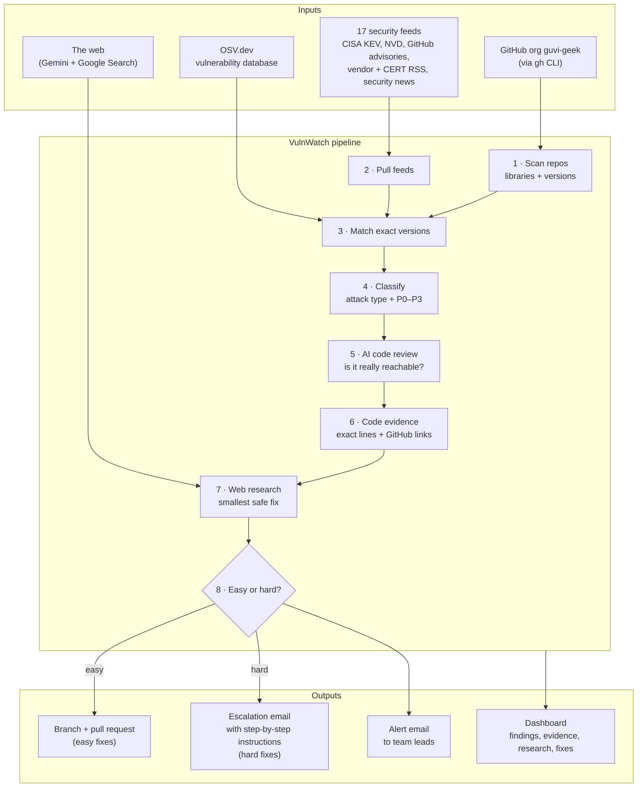

**Key ideas**

- **Exact versions, not names.** A library counts only if the *installed* version is known to be vulnerable. Lockfiles are read for that.
- **Confirmed = matched + reviewed.** A finding is "confirmed" only after the AI has looked at how the repo uses the library and said it is affected or possibly affected.
- **One finding per repo + library.** Pillow with 61 advisories is one finding, one fix, one email. It is not 61 tickets.
- **Cheap work first.** Scanning, matching and classifying cost nothing. Gemini runs only on confirmed, serious findings. The slowest, deepest step (web research) runs last and only on what is left.
- **Safe by default.** Auto-fix and email both start in dry-run mode: fixes stay on local branches and mails stay as previews until you switch them on.

---

## 2. One run, step by step

A run starts from the **Run check** button, or every `INTERVAL_MIN` minutes when `SCHEDULER=on`. Only one job runs at a time; every run is logged on the Runs page.

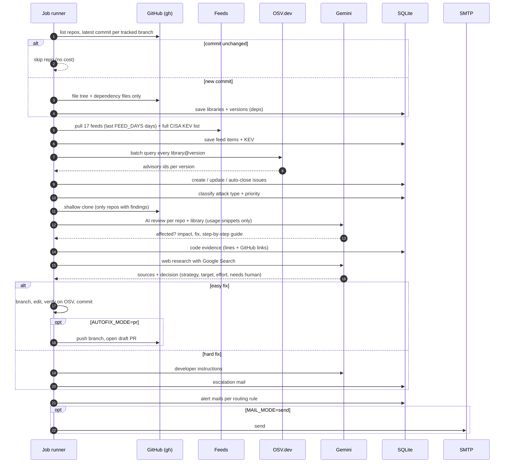

The run steps, in the order of `jobs.py`:

| # | Step | Module | Costs AI? |
|---|---|---|---|
| 1 | Sync repo list, scan changed repos | `inventory.py` | no |
| 2 | Pull feeds + KEV | `feeds.py` | no |
| 3 | Match versions on OSV, create/close issues | `matcher.py` | no |
| 4 | Attack type + priority | `classify.py` | no |
| 5 | AI review + fix guide (`AI_MAX_PER_RUN` per run) | `ai.py` | yes (flash + pro) |
| 6 | Code evidence for reviewed findings | `evidence.py` | no |
| 7 | Priority again (AI verdicts change it) | `classify.py` | no |
| 8 | Web research (`RESEARCH_MAX_PER_RUN` per run) | `research.py` | yes (pro + search) |
| 9 | Fix or escalate (`AUTOFIX_MAX_PER_RUN` per run) | `autofix.py` | only for escalations |
| 10 | Alert emails | `mailer.py` | no |

---

## 3. The stages in detail

### 3.1 Repositories and their libraries

`inventory.py` · `manifests.py` · `gh.py`

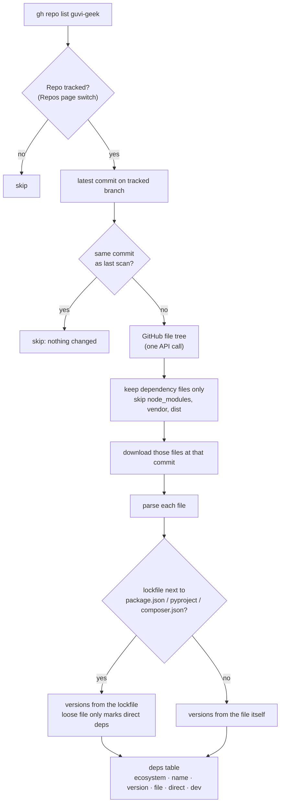

**Files understood**

| Ecosystem | Files |
|---|---|
| npm | `package-lock.json`, `yarn.lock`, `pnpm-lock.yaml`, `package.json` |
| PyPI | `requirements*.txt`, `pyproject.toml`, `poetry.lock`, `uv.lock`, `Pipfile.lock` |
| Go | `go.mod` (+ Go standard library from `golang:1.x.y` Docker images or a `toolchain` line) |
| PHP | `composer.lock`, `composer.json` |
| Java | `pom.xml`, `build.gradle(.kts)` |
| Ruby, Rust | `Gemfile.lock`, `Cargo.lock` |
| Docker | `Dockerfile*` base images (used for product matching, not OSV) |

**Rules worth knowing**

- **Lockfile wins.** `package.json` says `"vite": "^4.4.11"`; the lockfile says what is actually installed. Treating `^4.4.11` as `4.4.11` would invent false alarms.
- **Dev-only is tracked.** Lockfile `dev` flags, `devDependencies`, `require-dev`, `requirements-dev.txt`, and `tests/` folders mark a library as build/test only. That lowers its priority.
- **Branch is chosen per repo.** Default branch unless changed on the Repos page. Only that branch is ever read.
- **No clone here.** Everything comes through the GitHub API. Cloning happens later, and only for repos with findings.

### 3.2 Vulnerability feeds

`feeds.py` reuses `../vulnfeed/vulnfeed.py`. Sources live in `../vulnfeed/feeds.json`.

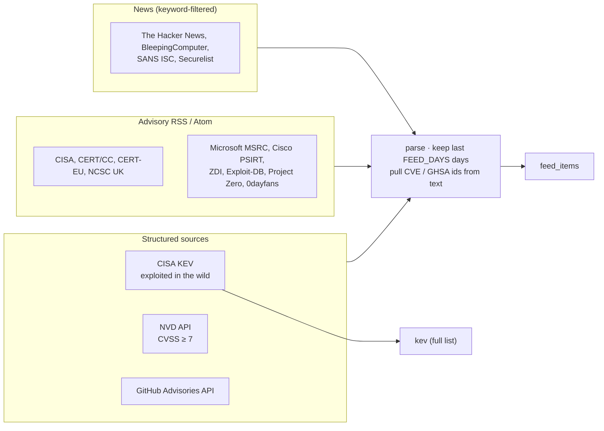

Feeds answer two questions for the matcher: **is this advisory recent news?** (`in_feed`) and **is it being exploited?** (`kev`). Each source is fetched independently with retries; one broken feed never stops a run.

### 3.3 Matching with OSV.dev

`matcher.py` · `osv.py`

Every `library@version` from tracked repos goes to OSV.dev in batches of 1,000. OSV answers with the advisory ids that affect **that exact version**. Each (advisory, repo, library) becomes one row in `issues`.

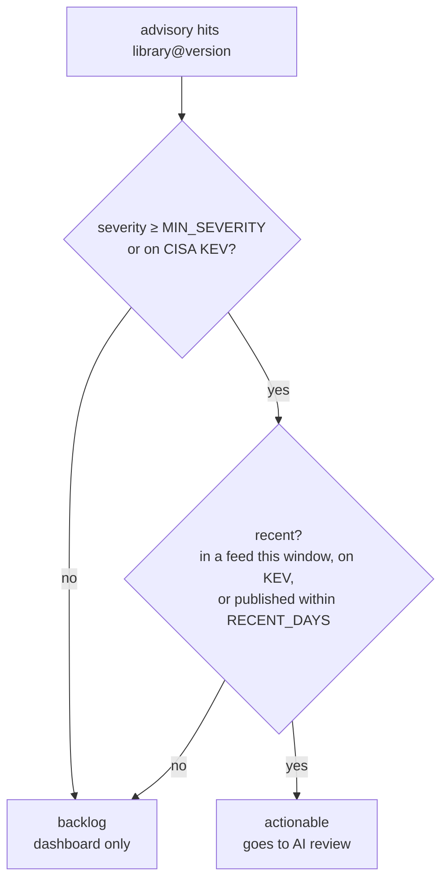

- **Severity** comes from the GitHub advisory record. When OSV has none (Go, PYSEC), it is borrowed from the GHSA alias.
- **Fixed versions** are read only from version ranges (not git commit ranges).
- **Auto-close:** an open issue that no longer appears after a rescan (library upgraded or removed) is marked **fixed** automatically.
- **Product advisories:** feed items that name a server product the repo runs as a Docker image (nginx, postgres, redis…) become "tech" issues. The AI review decides whether they apply.

### 3.4 Attack type and priority

`classify.py` (no AI)

**Attack type** comes from the advisory's CWE ids. When there are none, it comes from keywords in the advisory text. Generic CWEs (input validation, allow/deny lists) are ignored, so the text decides.

| Impact rank | Attack types |
|---|---|
| 1 (worst) | Remote code execution · Auth / access-control bypass · Injection (SQL / command) · Memory corruption |
| 2 | SSRF · File read/write (path traversal, XXE) · Request smuggling · Prototype pollution |
| 3 | TLS / crypto weakness · XSS · Information disclosure |
| 4 | Open redirect / CSRF · Denial of service |

**Priority**

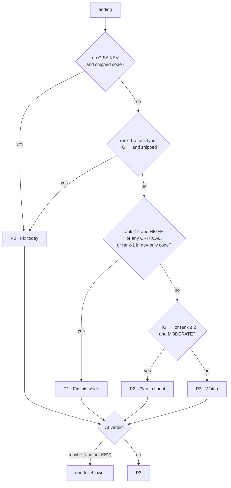

### 3.5 AI review of the code

`ai.py` · Gemini (flash for the verdict, pro for the guide)

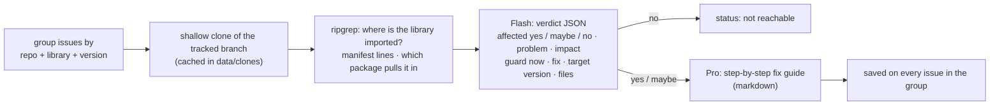

- **Only snippets are sent**, never whole repos: the matching import lines, the manifest lines, and the advisories (trimmed).
- **Model fallback.** Each step tries models in order (`GEMINI_TRIAGE_MODEL`, `GEMINI_GUIDE_MODEL`). A blocked or empty reply moves on to the next model. `gemini-flash-latest` is not used: in testing it blocked about half of security prompts.
- **Order:** P0 first, then exploited, then severity, up to `AI_MAX_PER_RUN` groups per run. Backlog items are reviewed only when someone presses **Analyze now**.

### 3.6 Code evidence

`evidence.py` (no AI)

For each reviewed finding, VulnWatch records the exact lines that prove it, each as a permalink to GitHub **at the scanned commit**, so the link never drifts:

| Kind | Example |
|---|---|
| Declared | `dashboard/package.json:18` → `"next": "16.2.9",` |
| Lockfile | `dashboard/package-lock.json:7311` → `"version": "16.2.9",` |
| Pulled in by | for transitive libraries: the direct dependency in `package.json` that brings it in |
| Used here | `roop/ui.py:8` → `from PIL import Image, ImageOps` |

The dashboard shows these as code blocks with the matching line highlighted. A click opens GitHub on that line.

### 3.7 Web research

`research.py` · Gemini pro with **Google Search grounding**

This is the "dig deeper" step. It runs on confirmed, open findings and is redone only when the set of advisories changes.

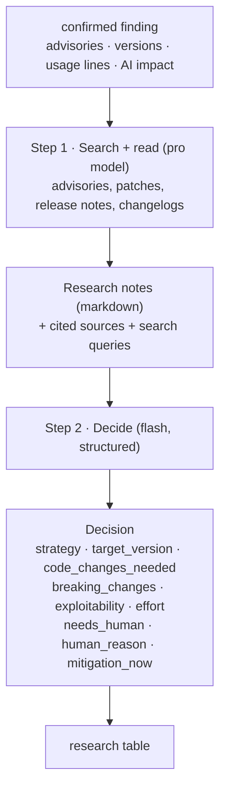

**What research covers**

1. Root cause and affected features of each advisory, and what an attacker needs.
2. Whether **this** repo's usage reaches the vulnerable code.
3. The lowest version that fixes **all** advisories, preferring the current major line.
4. Breaking changes between the installed and target version that touch the usage shown.
5. Options ranked by how little they change: patch, scoped override, config change, major upgrade, replace library.

**`needs_human` is strict.** It is true only when the fix cannot be automated safely: our code must change, a major migration, no fixed version, or a judgement call. "Someone should test it" does not count, because every fix is a PR that gets reviewed anyway.

**Strategies:** `patch_upgrade`, `minor_upgrade`, `major_upgrade`, `override_transitive`, `config_mitigation`, `replace_library`, `remove_unused`, `no_fix_available`.

### 3.8 Fix or escalate

`autofix.py`

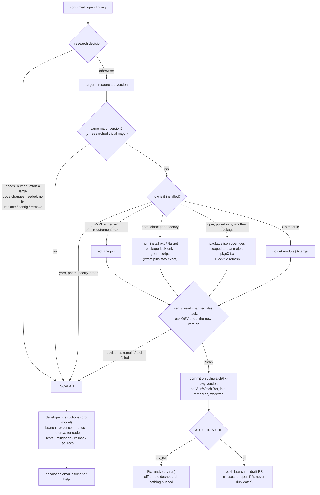

**What a pull request contains**

- **Title:** `fix(security): bump <pkg> to <version>`.
- **Body:** research summary; impact on this repo; severity and reachability; every advisory linked to osv.dev; what changed and which files; breaking changes; how it was verified; a merge checklist; today's mitigation; sources.
- **Draft PR** unless `AUTOFIX_PR_DRAFT=false`.

**Modes**

| `AUTOFIX_MODE` | What happens |
|---|---|
| `off` | Nothing is fixed or escalated |
| `dry_run` (default) | Branch, commit and diff stay local; dashboard shows **Fix ready (dry run)** |
| `pr` | Branch is pushed and a PR is opened; dashboard also offers a **Create PR** button on prepared fixes |

**Escalation email** goes to the routing rules for that repo when the finding's priority is P0–P`ESCALATE_MAX_PRIORITY`. It contains: why help is needed, what research found, impact, how reachable it is, the proposed fix, code changes, breaking changes, today's mitigation, the code location, sources, and the full step-by-step instructions.

### 3.9 Email

`mailer.py`

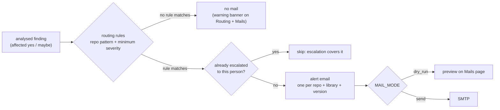

- **Rules** live on the Routing page: a repo pattern (`placement-*`, `*`), one or more emails, and a minimum severity (HIGH+ or CRITICAL/exploited only).
- **No duplicates:** each (finding, recipient) gets at most one alert, and at most one escalation per target version.
- **Alert email:** severity and exploited badge, problem, where (file + usage), impact for us, guard now, fix, research summary, auto-fix status (PR link / prepared / needs a developer), advisories, and a link to the dashboard.

---

## 4. Life of a finding

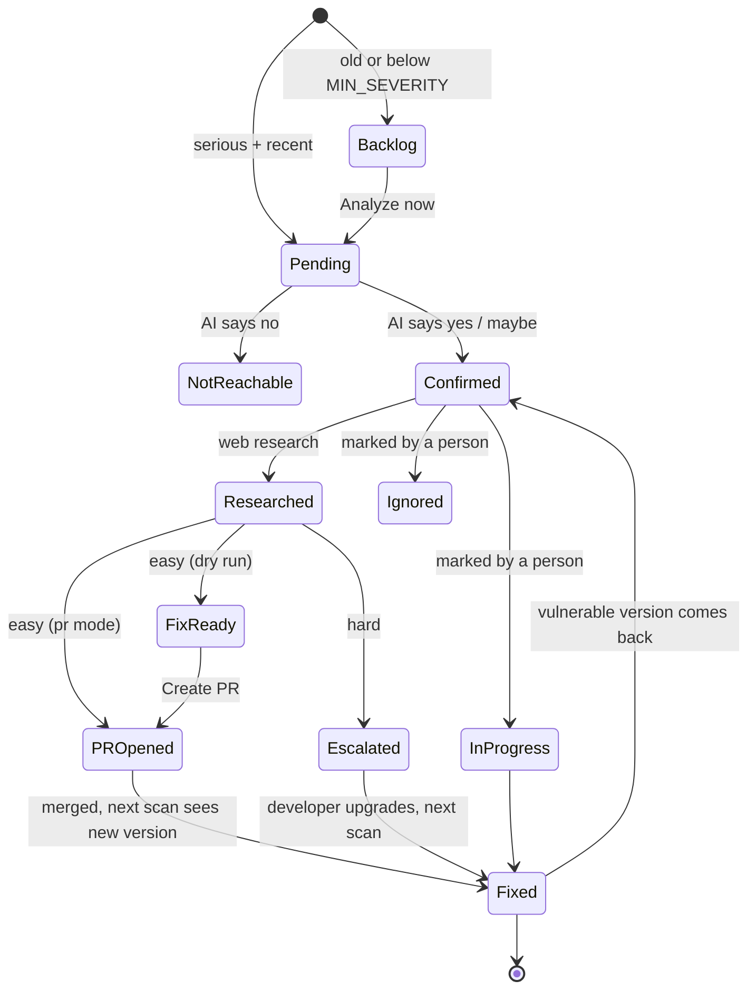

Statuses a person can set from the dashboard: **Open, In progress, Fixed, Ignored**. Each change shows a toast with **Undo**. **Fixed** is also set automatically when a rescan no longer finds the vulnerable version.

---

## 5. Checking any public repo

`checker.py` · page `/check`

Paste a GitHub link and get a verdict in seconds. Nothing is cloned or run.

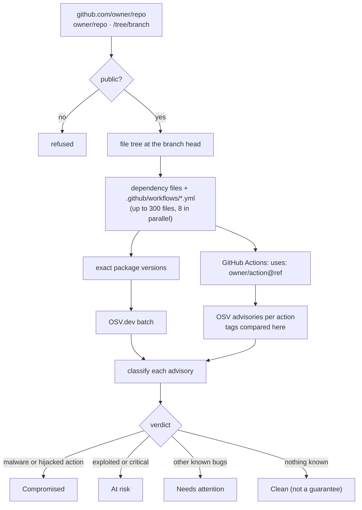

- **Malware** means an OSV `MAL-` entry, an advisory tagged CWE-506 (embedded malicious code), or a summary that names the package as malware or a compromised release. "A malicious user could…" bugs do **not** count.
- **GitHub Actions:** OSV does not compare action versions, so VulnWatch does. An exact tag (`v45.0.7`) is compared exactly; a moving tag (`v45`) is affected when its whole major line is older than the fix. Actions pinned to a branch or commit are listed as "check manually". There is also a hardening tip to pin actions to commit SHAs.
- **Suggested upgrade:** the lowest fixed version at or above the installed one, same major line first, pre-releases last.
- **Shareable:** every check gets a URL `/check/<id>` and appears under "Recent checks".

**Example results**

| Repo | Verdict |
|---|---|
| `bradtraversy/spacex_launch_stats` | Compromised: `fsevents 1.2.4`, `event-stream 3.3.6`, `flatmap-stream 0.1.1`; plus 118 vulnerable packages |
| `expressjs/express` | Clean (44 packages, 7 actions) |

---

## 6. Data model

All state is one SQLite file: `vulnwatch/data/vulnwatch.db` (git-ignored).

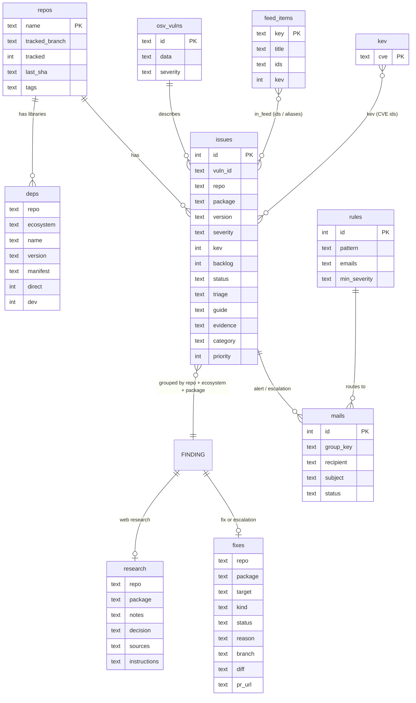

`FINDING` is not a table. It is how `findings.py` groups `issues` (one per repo + library) for the dashboard, research, fixes and mail.

| Table | Holds |
|---|---|
| `repos` | Org repos, tracked switch, tracked branch, last scanned commit |
| `deps` | Every library + version per repo, file, direct/dev flags |
| `feed_items`, `kev` | Recent feed items with extracted ids; full CISA KEV list |
| `osv_vulns` | Cached OSV advisory records |
| `issues` | One row per (advisory, repo, library): severity, status, AI verdict + guide, evidence, attack type, priority |
| `research` | Web research notes, decision, sources, developer instructions |
| `fixes` | Fix plan and outcome: kind, target, status, branch, diff, PR URL, reason |
| `rules`, `mails` | Routing rules; every alert/escalation (preview, sent, failed) |
| `checks` | Results of public-repo checks |
| `runs` | Every job with its log |

---

## 7. The dashboard

`web.py` + `templates/` · FastAPI, Jinja, Alpine.js, static Tailwind CSS · light / dark / system theme · works down to phone width.

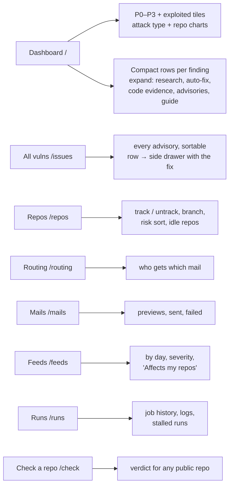

| Page | Use it to |
|---|---|
| **Dashboard** | See confirmed findings by priority. Open one for research, auto-fix status, code lines, advisories and the fix guide. Mark as in progress / fixed / ignored. |
| **All vulns** | Browse every advisory. A row opens a drawer with the fix (`/issues/<id>` links from emails land here). |
| **Repos** | Turn monitoring on/off per repo, pick the branch, spot idle repos. |
| **Routing** | Add rules: repo pattern → team lead emails, minimum severity. |
| **Mails** | Review previews before switching on sending; send manually. |
| **Feeds** | Read recent advisories; "Affects my repos" shows only relevant ones. |
| **Runs** | Check what each job did; mark stalled runs as failed. |
| **Check a repo** | Verdict for any public GitHub repo. |

The dashboard reloads its data every 10 seconds. New findings appear as a "N new findings · show" pill, so nothing reorders while you read.

---

## 8. Configuration

All settings are in `vulnwatch/.env` (template: `.env.example`). Restart the app after changing them.

| Setting | Default | Meaning |
|---|---|---|
| `GITHUB_ORG` | `guvi-geek` | Org to monitor |
| `DASHBOARD_URL` | `http://127.0.0.1:8000` | Used for links in emails; set to a reachable address once hosted |
| `GEMINI_API_KEY` | from shell | Gemini key |
| `GEMINI_TRIAGE_MODEL` | `gemini-3.5-flash,gemini-2.5-flash` | Verdicts and decisions (tried in order) |
| `GEMINI_GUIDE_MODEL` | `gemini-pro-latest,gemini-3.5-flash` | Guides, research, instructions |
| `FEED_DAYS` | `3` | Feed lookback |
| `RECENT_DAYS` | `30` | Older advisories are backlog unless in a feed or exploited |
| `MIN_SEVERITY` | `HIGH` | Lowest severity that is actionable (KEV always is) |
| `SCHEDULER` / `INTERVAL_MIN` | `on` / `30` | Automatic runs |
| `AI_MAX_PER_RUN` | `10` | AI reviews per run |
| `RESEARCH_MAX_PER_RUN` | `10` | Web research per run (~1 min each) |
| `AUTOFIX_MODE` | `dry_run` | `off` · `dry_run` · `pr` |
| `AUTOFIX_MAX_PER_RUN` | `5` | Fixes per run |
| `AUTOFIX_PR_DRAFT` | `true` | Open PRs as drafts |
| `ESCALATE_MAX_PRIORITY` | `1` | Escalation email for P0..this priority (3 = every hard fix) |
| `MAIL_MODE` | `dry_run` | `dry_run` keeps previews · `send` delivers |
| `SMTP_HOST`, `SMTP_PORT`, `SMTP_USER`, `SMTP_PASS`, `SMTP_FROM`, `SMTP_TLS` | — | Mail server (`starttls` for 587, `ssl` for 465). For Gmail, `SMTP_PASS` is an App Password. |

---

## 9. Running it

```bash
cd vulnwatch
../.venv/bin/python run.py          # dashboard on http://127.0.0.1:8000
```

| Need | Command / place |
|---|---|
| Run everything now | **Run check** in the header |
| One step only | `POST /api/run/<job>`: `repos`, `rescan`, `feeds`, `match`, `classify`, `ai`, `research`, `autofix`, `mail` |
| Rebuild CSS after template changes | `cd tools && npm install && npm run css` |
| Requirements | Python 3.12+, `gh` logged in with access to the org, `git`, `ripgrep`, Node/npm (for npm fixes), Go (for Go fixes), Gemini API key |

Turning features on, in order:

1. Add a routing rule (Routing page).
2. Fill the SMTP settings, restart, and press **Send test** on the Routing page.
3. Check the previews on the Mails page, then set `MAIL_MODE=send`.
4. Look at a few prepared fixes on the dashboard (**View diff**), then set `AUTOFIX_MODE=pr`.
5. Set `SCHEDULER=on`.

---

## 10. Safety: what it can and cannot do

| Area | Behaviour |
|---|---|
| GitHub access | Uses your `gh` login. Read-only until `AUTOFIX_MODE=pr`; then it only pushes `vulnwatch/fix-*` branches and opens PRs. It never merges or touches other branches. |
| Credentials | Git uses `gh` as its only credential helper, so no token appears on a command line. SMTP and Gemini keys stay in `.env`. |
| Code execution | Repo code is never run. Package managers run with `--ignore-scripts` / `--package-lock-only`; Go with `GOTOOLCHAIN=local`. |
| Private code to AI | Only the matching import lines, manifest lines and advisory text go to Gemini, never whole files or repos. |
| AI output | Rendered with raw HTML disabled, so text from models or advisories cannot inject HTML into the dashboard or emails. |
| Public repo checks | Private repos are refused, so the page can't be used to read org code. |
| Mistakes | PRs are drafts by default; every fix is verified against OSV before commit; status changes have Undo. |

---

## 11. Limits

- **Known vulnerabilities only.** Unreported malware and bugs in your own code are not detected.
- **Exact versions needed.** Libraries without a lockfile or pin have no exact version and are not matched.
- **Auto-fix coverage:** requirements pins, npm with `package-lock.json`, and Go modules. yarn, pnpm, poetry, Maven and others are escalated.
- **Verification is lockfile + OSV, not your test suite.** PRs ask for CI and a smoke test before merging.
- **Research can be wrong.** Escalations state their reasoning and sources; check big calls (e.g. "needs a major upgrade") before acting.
- **Local only for now.** Email links point to `DASHBOARD_URL`; until the app is hosted, they open only on this machine.

---

## 12. Code map

```text
vulnwatch/
├── run.py                  start the dashboard
├── .env / .env.example     settings
├── app/
│   ├── config.py           settings from .env
│   ├── db.py               SQLite schema + helpers
│   ├── gh.py               all GitHub access (gh CLI, clones, credential helper)
│   ├── inventory.py        repo sync + dependency scan
│   ├── manifests.py        dependency file parsers
│   ├── feeds.py            feeds + CISA KEV (uses ../vulnfeed)
│   ├── osv.py              OSV.dev client + cache
│   ├── matcher.py          issues: create, update, auto-close
│   ├── classify.py         attack type + P0–P3
│   ├── ai.py               usage search, Gemini verdict + fix guide
│   ├── evidence.py         code lines + GitHub permalinks
│   ├── research.py         web research, decision, developer instructions
│   ├── autofix.py          plan, apply, verify, commit, PR; escalation
│   ├── mailer.py           routing, alert + escalation emails, SMTP
│   ├── findings.py         issues → findings (one per repo + library)
│   ├── checker.py          public repo check
│   ├── jobs.py             job runner, pipeline order, scheduler
│   ├── web.py              pages + JSON API
│   ├── templates/          pages and shared partials
│   └── static/             app.css (built), vw.js
├── tools/                  Tailwind build (input.css, config)
├── data/                   database, clones, fix worktrees (git-ignored)
└── docs/HOW-IT-WORKS.md    this document
```
